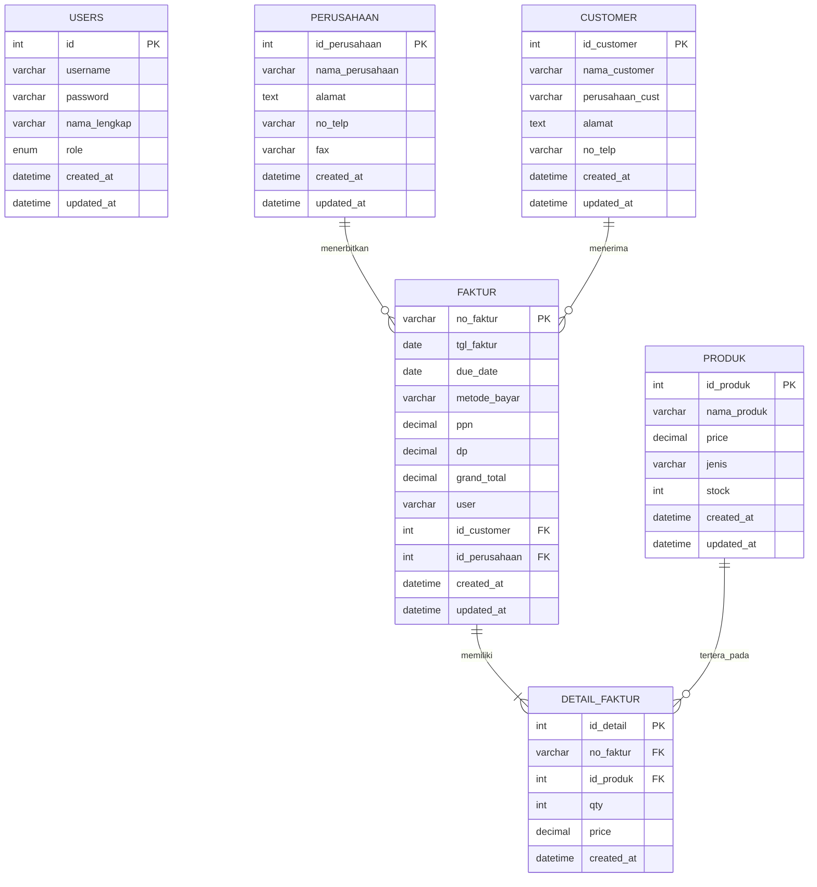
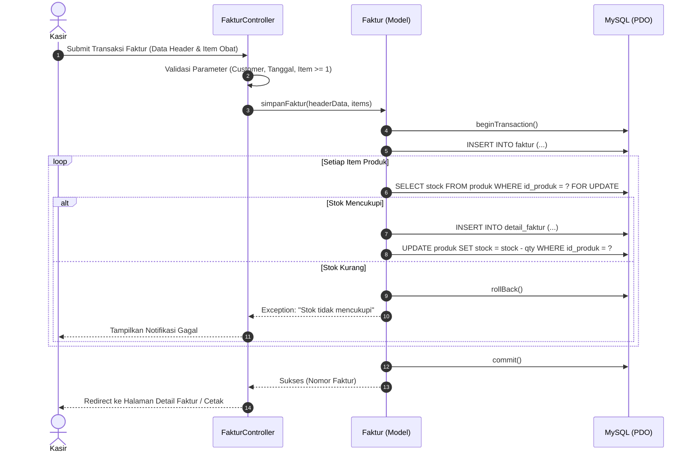

# SPESIFIKASI KEBUTUHAN PERANGKAT LUNAK (SRS)
## Sistem Informasi Manajemen Apotek LSP

---

## 1. Deskripsi Umum Sistem

**Apotek LSP** adalah sistem informasi berbasis web yang dirancang untuk mengelola proses bisnis operasional apotek secara terintegrasi. Sistem ini menangani pencatatan profil apotek/perusahaan penerbit, manajemen data pelanggan/rekanan, katalog obat dan produk farmasi, penerbitan faktur penjualan multi-item dengan prinsip transaksi atomik (*ACID Transaction*), pencetakan faktur resmi, serta modul pelaporan penjualan dan persediaan.

Aplikasi dibangun dengan arsitektur **MVC (Model-View-Controller)** menggunakan bahasa pemrograman **PHP** berstandar **PSR-12** dan basis data relasional **MySQL** via **PDO (PHP Data Objects)**.

---

## 2. Kebutuhan Sistem (System Requirements)

### 2.1 Kebutuhan Fungsional (Functional Requirements)

1. **Modul Dashboard (Beranda)**
   - Menampilkan metrik ringkasan eksekutif: Total Omset Penjualan, Total Faktur Diterbitkan, Total Produk, dan Total Pelanggan Terdaftar.
   - Peringatan dini (*Early Warning System*) untuk produk dengan kuantitas stok menipis (<= 15 unit).
   - Tabel riwayat transaksi faktur penjualan terkini beserta status jatuh tempo.

2. **Modul Kelola Data Perusahaan**
   - Menampilkan daftar identitas apotek/perusahaan penerbit faktur beserta fasilitas paginasi dan pencarian.
   - Pengelolaan formulir tambah, ubah, dan hapus data instansi perusahaan (`id_perusahaan`, `nama_perusahaan`, `alamat`, `no_telp`, `fax`).

3. **Modul Kelola Data Customer**
   - Menampilkan dan mengelola data rekanan/pelanggan (`id_customer`, `nama_customer`, `perusahaan_cust`, `alamat`, `no_telp`).
   - Formulir tambah, ubah, dan hapus data pelanggan.
   - Fitur **Cetak Data Customer** dalam format rekapitulasi formal siap cetak/PDF.

4. **Modul Kelola Data Produk & Obat**
   - Menampilkan katalog inventaris obat dan barang farmasi (`id_produk`, `nama_produk`, `price`, `jenis`, `stock`).
   - Formulir tambah, ubah, dan hapus data produk dengan verifikasi integritas data relasional.
   - Indikator status ketersediaan stok (Aman, Menipis, Habis).

5. **Modul Kelola Faktur & Penjualan**
   - Menampilkan riwayat transaksi faktur penjualan dengan penyaringan rentang tanggal dan pencarian nomor faktur.
   - **Formulir Faktur Multi-Item:** Keranjang produk interaktif dengan kalkulasi otomatis Subtotal, PPN (11%), Uang Muka (DP), dan Grand Total.
   - Penentuan tanggal jatuh tempo otomatis berdasarkan pilihan pembayaran tempo.
   - Tombol simpan dinonaktifkan jika belum ada produk yang dipilih dalam transaksi.
   - Pemotongan kuantitas stok otomatis dengan perlindungan transaksi atomik (`PDO Transaction`).
   - **Cetak Faktur Penjualan:** Dokumen faktur resmi lengkap dengan kop instansi apotek, nomor surat izin apotek, rincian produk, ringkasan pembayaran, dan kolom tanda tangan.

6. **Modul Laporan Eksekutif**
   - **Laporan Penjualan:** Penyaringan data berdasarkan rentang tanggal dan metode pembayaran, ringkasan total omset dan laba kotor, serta opsi cetak dan ekspor CSV.
   - **Laporan Produk & Stok:** Penyaringan data berdasarkan kategori sediaan dan status stok, valuasi nilai persediaan, cetak dokumen, dan ekspor CSV.

7. **Modul Kelola Pengguna & Hak Akses**
   - Pengelolaan akun pengguna internal (`admin`, `petugas`, `manajer`).
   - Kontrol hak akses berbasis peran (Role-Based Access Control).

### 2.2 Kebutuhan Non-Fungsional (Non-Functional Requirements)

1. **Keamanan (Security):**
   - Pencegahan SQL Injection melalui penggunaan PDO Prepared Statements secara konsisten.
   - Pencegahan serangan Cross-Site Scripting (XSS) melalui sanitasi keluaran HTML (`htmlspecialchars`).
   - Pencegahan Cross-Site Request Forgery (CSRF) dengan token verifikasi per sesi pada seluruh formulir POST.
   - Penyimpanan kata sandi terenkripsi menggunakan algoritma BCRYPT (`password_hash`).
   - Dialog konfirmasi interaktif sebelum eksekusi aksi destruktif (hapus data, logout).

2. **Performa & Portabilitas:**
   - Beroperasi mandiri pada lingkungan server lokal (Laragon atau XAMPP) tanpa dependensi eksternal.
   - Paginasi data dinamis pada tingkat basis data (SQL `LIMIT` & `OFFSET`).
   - Clean URL melalui modul Apache `mod_rewrite`.

---

## 3. Struktur Basis Data Relasional

### Penjelasan Entitas:
1. **`users`**: Menyimpan identitas akun pengguna dan peran sistem (Administrator, Petugas, Manajer).
2. **`perusahaan`**: Menyimpan profil instansi apotek/perusahaan penerbit faktur.
3. **`customer`**: Menyimpan data rekanan/pelanggan penerima faktur.
4. **`produk`**: Menyimpan katalog obat dan barang farmasi beserta stok dan harga satuan.
5. **`faktur`**: Menyimpan ringkasan transaksi penjualan (header faktur).
6. **`detail_faktur`**: Menyimpan rincian setiap item obat/barang dalam transaksi faktur.

---

## 4. Alur Transaksi Faktur (ACID Transaction)

---

## 5. Pengujian Unit Sistem

Pengujian unit dilakukan secara otomatis melalui test runner mandiri (`tests/run.php`) yang menguji:
- **`DatabaseTest`**: Konektivitas PDO dan eksekusi query prepared statement.
- **`AuthTest`**: Enkripsi password BCRYPT dan logika otorisasi peran pengguna.
- **`ValidationTest`**: Validasi aturan input (required, numeric, email).
- **`ModelTest`**: Ketersediaan data master awal, format kode faktur, dan integritas relasi antar tabel.
