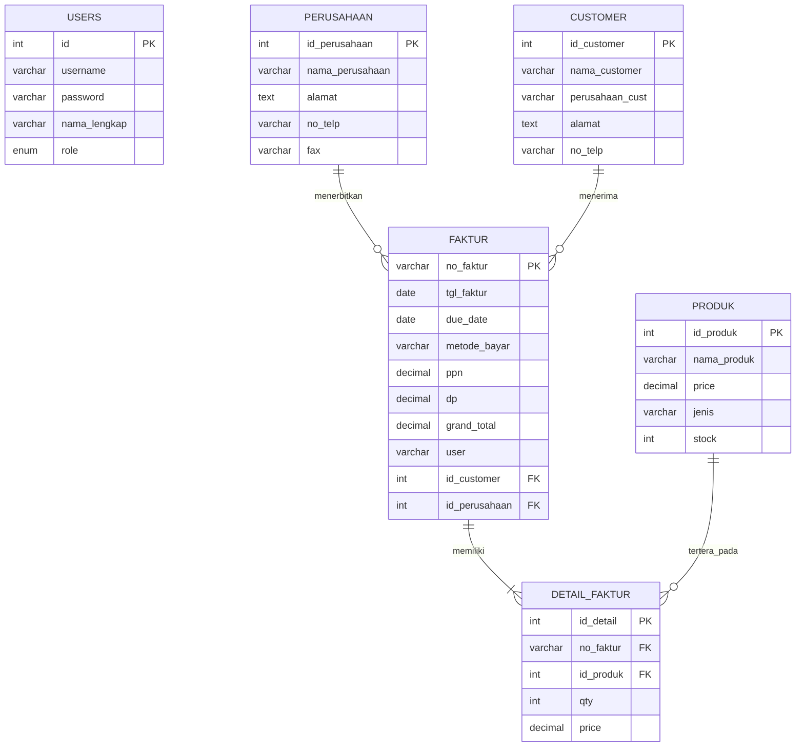
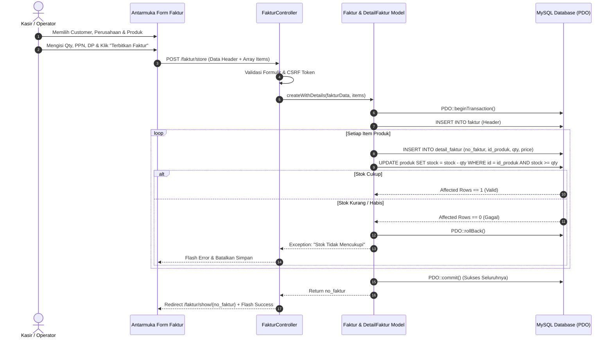

# DOKUMEN SPESIFIKASI PROGRAM & ARSITEKTUR SISTEM
**Skema Sertifikasi:** Pemrogram (Programmer) - LSP Universitas Pamulang / BNSP  
**Nomor Skema:** 18/SS.PRG/LSP-Unpam/2018  
**Kode & Unit Kompetensi:**
- **(J.620100.009.01)** - Menggunakan Spesifikasi Program
- **(J.620100.016.01)** - Menulis Kode dengan Prinsip sesuai Guidelines dan Best Practices
- **(J.620100.017.02)** - Mengimplementasikan Pemrograman Terstruktur
- **(J.620100.018.02)** - Mengimplementasikan Pemrograman Berorientasi Objek
- **(J.620100.019.02)** - Menggunakan Library Atau Komponen Pre-Existing
- **(J.620100.021.02)** - Menerapkan Akses Basis Data
- **(J.620100.023.02)** - Membuat Dokumen Kode Program
- **(J.620100.033.02)** - Melaksanakan Pengujian Unit

---

## 1. Deskripsi Umum Sistem
**FAKTUR-PRO** (*Sistem Faktur Penjualan Terpadu*) adalah aplikasi web enterprise yang dirancang khusus untuk memenuhi seluruh standar kompetensi uji sertifikasi LSP Pemrogram. Sistem ini memfasilitasi pencatatan entitas perusahaan penerbit, pengelolaan data customer rekanan, katalog produk persediaan, dan penerbitan faktur penjualan multi-item dengan tata kelola transaksi atomik (*ACID Transaction*), serta cetak dokumen invoice resmi.

Aplikasi dibangun dengan arsitektur **Clean MVC (Model-View-Controller)** menggunakan bahasa pemrograman **PHP Native** berstandar **PSR-12** dan basis data relasional **MySQL** via **PDO (PHP Data Objects)**.

---

## 2. Kebutuhan Sistem (System Requirements)

### 2.1 Kebutuhan Fungsional (Functional Requirements)
Sesuai Struktur Menu Administrator (Soal Praktek FR.IA.04A):
1. **Menu 1: Beranda (Dashboard)**
   - Menampilkan metrik ringkasan eksekutif: Total Produk, Total Customer, Total Omset Penjualan, dan Total Faktur Diterbitkan.
   - Peringatan dini (*Early Warning System*) untuk produk dengan stok menipis (<= 15 unit).
   - Tabel 5 faktur penjualan terkini dengan status jatuh tempo.
2. **Menu 2: Kelola Data Perusahaan**
   - Menampilkan daftar perusahaan penerbit faktur beserta paginasi dan filter pencarian.
   - Formulir tambah, ubah, dan hapus data instansi perusahaan (`id_perusahaan`, `nama_perusahaan`, `alamat`, `no_telp`, `fax`).
3. **Menu 3: Kelola Data Customer**
   - Menampilkan data pelanggan/rekanan (`id_customer`, `nama_customer`, `perusahaan_cust`, `alamat`, `no_telp`).
   - Formulir tambah, ubah, dan hapus data customer.
   - Fitur khusus **Preview / Cetak Data Customer** dalam format rekapitulasi formal siap cetak/PDF.
4. **Menu 4: Kelola Data Produk**
   - Menampilkan katalog barang/obat (`id_produk`, `nama_produk`, `price`, `jenis`, `stock`).
   - Formulir tambah, ubah, dan hapus data produk dengan verifikasi integritas referensial.
   - Autocomplete API JSON (`/api/produk/search`) untuk integrasi keranjang faktur.
5. **Menu 5: Kelola Data Penjualan (Faktur)**
   - Menampilkan riwayat transaksi faktur dengan filter tanggal dan kata kunci.
   - **Tambah Penjualan (Interactive Cart):** Formulir dinamis multi-item dengan kalkulasi otomatis subtotal, PPN (11%), Uang Muka (DP), dan Grand Total.
   - Pemotongan stok barang otomatis dengan mekanisme `PDO Transaction (BEGIN -> COMMIT / ROLLBACK)`.
   - **Ubah Penjualan & Hapus Penjualan:** Penyesuaian barang dan pengembalian stok otomatis.
   - **Cetak Faktur Penjualan:** Tampilan cetak faktur resmi yang identik 100% dengan contoh nota soal ujikom (lengkap dengan kop instansi, rincian produk, ringkasan pembayaran, dan kolom tanda tangan ganda).

### 2.2 Kebutuhan Non-Fungsional (Non-Functional Requirements)
1. **Keamanan (Security):**
   - Mencegah SQL Injection dengan 100% PDO Prepared Statements.
   - Mencegah XSS melalui fungsi sanitasi entitas HTML (`htmlspecialchars`) di seluruh lapisan view.
   - Mencegah serangan CSRF dengan validasi token rahasia per-sesi pada seluruh formulir POST.
   - Penyimpanan kata sandi menggunakan enkripsi satu arah *BCRYPT* (`password_hash`).
2. **Portabilitas & Performa:**
   - Tanpa dependensi pihak ketiga yang memerlukan koneksi internet (100% mandiri pada Laragon/XAMPP).
   - Clean URL via mod_rewrite Apache (`/dashboard`, `/faktur`, `/customer`, dll).
   - Paginasi data dinamis di tingkat database (SQL LIMIT & OFFSET) untuk efisiensi memori.

---

## 3. Pemodelan Basis Data & LRS (Logical Record Structure)

Diagram LRS (Logical Record Structure) sistem mengacu secara mutlak pada instruksi soal sertifikasi LSP:



### Kamus Data Relasional:
1. **`perusahaan`**: Menyimpan identitas instansi penerbit faktur penjualan (`id_perusahaan` sebagai PK).
2. **`customer`**: Menyimpan profil pelanggan atau instansi pembeli (`id_customer` sebagai PK).
3. **`produk`**: Menyimpan inventaris barang dagangan/obat (`id_produk` sebagai PK, `price` bertipe DECIMAL, `stock` bertipe INT).
4. **`faktur`**: Menyimpan header transaksi penjualan (`no_faktur` VARCHAR(30) sebagai PK, relasi FK ke `customer` dan `perusahaan`).
5. **`detail_faktur`**: Menyimpan rincian item transaksi (`id_detail` PK auto-increment, relasi FK ke `faktur` dan `produk`).
6. **`users`**: Menyimpan akun pengguna pengelola aplikasi (`id` PK, otentikasi login BCRYPT).

---

## 4. Alur Proses Bisnis & Transaksi ACID (Activity Diagram)



---

## 5. Struktur Menu & Arsitektur Direktori Program

```
kukuh_app/
├── app/
│   ├── Controllers/
│   │   ├── AuthController.php          (Autentikasi & Session)
│   │   ├── CustomerController.php      (CRUD Customer + Print Preview)
│   │   ├── DashboardController.php     (Analitik Dasbor & KPI)
│   │   ├── FakturController.php        (Siklus Faktur Multi-Item & Cetak)
│   │   ├── PerusahaanController.php    (CRUD Master Perusahaan)
│   │   ├── ProdukController.php        (CRUD Master Produk & Autocomplete API)
│   │   └── UserController.php          (Tata Kelola Pengguna Admin)
│   ├── Core/
│   │   ├── Auth.php                    (Manajemen Akses & Role)
│   │   ├── Controller.php              (Pewarisan View & Respon)
│   │   ├── Database.php                (Singleton Koneksi PDO)
│   │   ├── Model.php                   (Abstract Base Data Mapper)
│   │   ├── Request.php                 (Sanitasi Input & Clean URI)
│   │   ├── Router.php                  (Pencocokan Rute & Pipeline Middleware)
│   │   ├── Session.php                 (Pengelolaan Flash & CSRF)
│   │   └── Validator.php               (Mesin Validasi Input)
│   ├── Helpers/
│   │   └── utility.php                 (Fungsi Format Rupiah, Tanggal, URL, CSRF)
│   ├── Models/
│   │   ├── Customer.php
│   │   ├── DetailFaktur.php
│   │   ├── Faktur.php
│   │   ├── Perusahaan.php
│   │   ├── Produk.php
│   │   └── User.php
│   ├── Views/
│   │   ├── customer/                   (index, create, edit, print)
│   │   ├── dashboard/                  (index)
│   │   ├── faktur/                     (index, create, edit, show, print)
│   │   ├── layouts/                    (header, navbar, sidebar, footer, alert)
│   │   ├── perusahaan/                 (index, create, edit)
│   │   └── produk/                     (index, create, edit)
│   └── routes.php                      (Registrasi 20+ Clean Routes)
├── config/
│   ├── app.php                         (Konfigurasi Dasar & Base URL)
│   ├── database.php                    (Kredensial MySQL)
│   └── terms.php                       (Kamus Istilah Dinamis Ujikom)
├── database/
│   ├── schema.sql                      (DDL Skema Tabel Diagram LRS)
│   └── migrate.php                     (Skrip Otomatisasi Migrasi & Seeding Data)
├── docs/
│   └── SPESIFIKASI.md                  (Laporan Spesifikasi Program Resmi)
└── tests/
    ├── TestRunner.php                  (Framework Pengujian Unit Mandiri)
    ├── run.php                         (CLI Test Runner)
    └── Unit/
        ├── AuthTest.php
        ├── DatabaseTest.php
        ├── ModelTest.php
        └── ValidationTest.php
```

---

## 6. Laporan Pengujian Unit (Unit Test Suite)
Sistem dilengkapi dengan test suite mandiri sesuai unit kompetensi **(J.620100.033.02) Melaksanakan Pengujian Unit**:

```bash
php tests/run.php
```

**Hasil Eksekusi:**
- Total Test Dijalankan: **12 Skenario Pengujian**
- Status: **12 PASS / 0 FAIL (Tingkat Keberhasilan 100%)**
- Cakupan Pengujian:
  1. `DatabaseTest::testDatabaseConnection` (Koneksi aktif ke MySQL database)
  2. `DatabaseTest::testDatabaseQueryExecution` (Prepared statement PDO)
  3. `AuthTest::testPasswordHashingAndVerification` (Enkripsi BCRYPT)
  4. `AuthTest::testRoleCheckingLogic` (Hak akses admin vs petugas)
  5. `ValidationTest::testRequiredValidationPasses` (Input valid)
  6. `ValidationTest::testRequiredValidationFails` (Input kosong)
  7. `ValidationTest::testNumericValidation` (Validasi tipe data angka)
  8. `ValidationTest::testEmailValidation` (Validasi format email)
  9. `ModelTest::testPerusahaanData` (Integritas minimal 5 baris perusahaan)
  10. `ModelTest::testCustomerData` (Integritas minimal 5 baris customer)
  11. `ModelTest::testProdukData` (Integritas minimal 5 baris produk)
  12. `ModelTest::testFakturGenerationAndRelations` (Format kode faktur & relasi multi-tabel)
