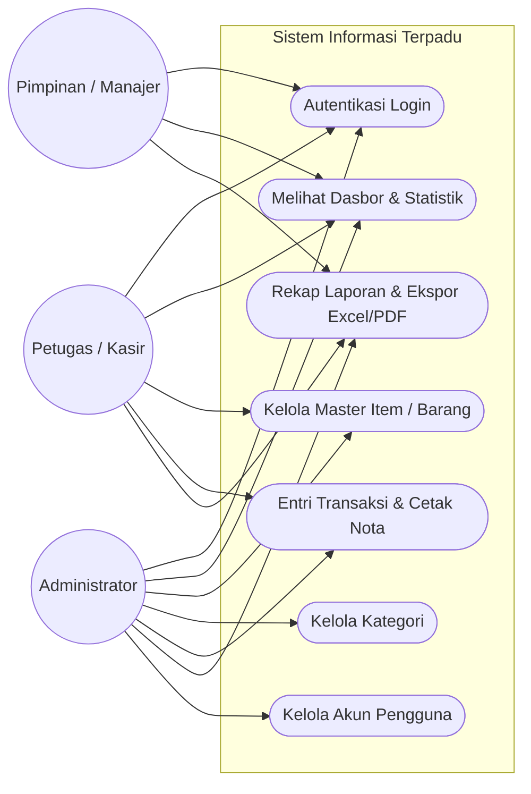
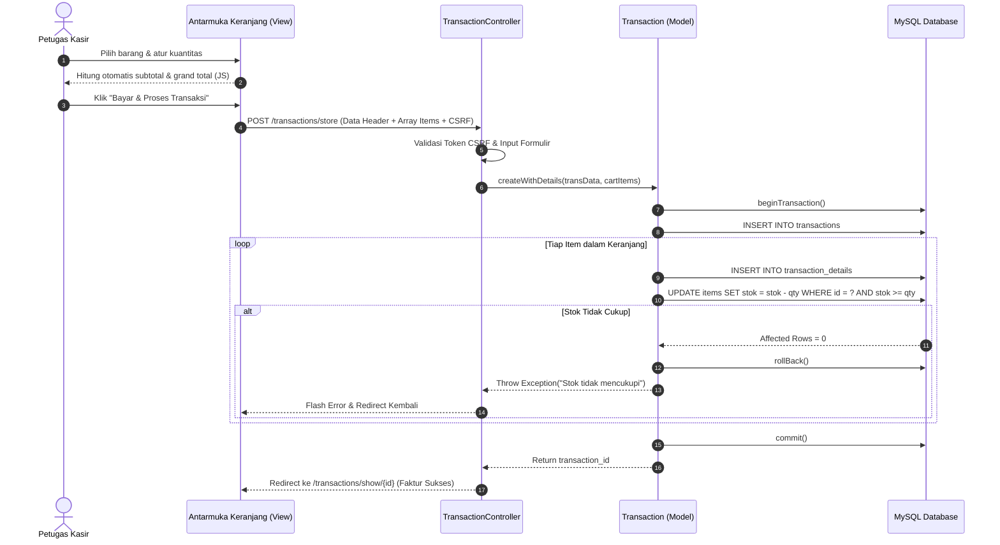
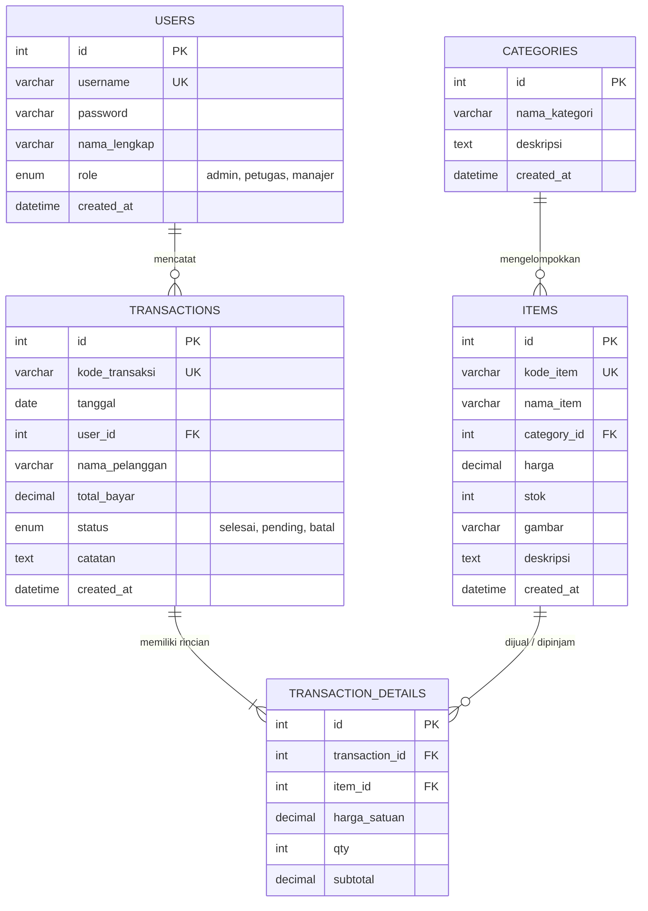

# DOKUMEN SPESIFIKASI PROGRAM & ARSITEKTUR SISTEM
**Standar Kompetensi Kerja Nasional Indonesia (SKKNI)**
- **Unit Kompetensi 1:** (J.620100.009.01) - Menggunakan Spesifikasi Program
- **Unit Kompetensi 7:** (J.620100.023.02) - Membuat Dokumen Kode Program

---

## 1. Deskripsi Umum Sistem
**SIM-PRO** (*Sistem Informasi Manajemen Terpadu*) adalah aplikasi berbasis web yang dirancang untuk mengelola inventaris master data, pemrosesan transaksi multi-item, rekapitulasi pelaporan periodik, dan tata kelola akun pengguna dengan pembagian hak akses (*Role-Based Access Control*).

Sistem ini dibangun dengan arsitektur **Clean MVC (Model-View-Controller)** menggunakan bahasa pemrograman **PHP Native** berstandar **PSR-12** dan basis data relasional **MySQL** via **PDO**.

---

## 2. Kebutuhan Sistem

### 2.1 Kebutuhan Fungsional (Functional Requirements)
1. **Modul Autentikasi & Otorisasi:**
   - Pengguna dapat masuk (*login*) menggunakan username dan password yang terenkripsi BCRYPT.
   - Sistem membedakan hak akses menjadi 3 peran: **Administrator**, **Petugas/Operator**, dan **Manajer/Pimpinan**.
   - Sistem menyediakan perlindungan *Session Fixation* dan regenerasi sesi saat login.
2. **Modul Master Data (Item & Kategori):**
   - Menampilkan daftar data dengan pencarian kata kunci dan penyaringan kategori.
   - Paginasi data dinamis untuk menjaga performa rendering memori.
   - Operasi CRUD (Create, Read, Update, Delete) lengkap dengan unggah gambar produk.
3. **Modul Transaksi & Keranjang Interaktif:**
   - Pencatatan transaksi multi-item dalam satu kesatuan nota (*Interactive Cart*).
   - Pengurangan stok barang secara otomatis dan verifikasi ketersediaan stok (*ACID Transaction*).
   - Pencetakan faktur/nota resmi dalam format cetak ramah printer atau PDF.
4. **Modul Rekapitulasi & Pelaporan:**
   - Penyaringan transaksi berdasarkan rentang tanggal (*Date Range Filter*).
   - Ekspor rekap transaksi ke format **Excel/CSV** native dengan standar UTF-8 BOM.
   - Dokumen cetak laporan formal yang dilengkapi kolom pengesahan penguji/pimpinan.
5. **Modul Manajemen Pengguna:**
   - Administrator dapat menambah, memperbarui, dan menghapus akun pengguna sistem.

### 2.2 Kebutuhan Non-Fungsional (Non-Functional Requirements)
1. **Keamanan (Security):**
   - Bebas celah SQL Injection dengan Prepared Statements PDO 100%.
   - Proteksi XSS (*Cross-Site Scripting*) via sanitasi entitas HTML global.
   - Proteksi CSRF (*Cross-Site Request Forgery*) dengan token terenkripsi pada setiap formulir POST.
2. **Kemandirian Lingkungan (Portabilitas / Offline-First):**
   - Tidak memerlukan *build tool* (Node.js/NPM) maupun Composer saat dijalankan di komputer lab.
   - Seluruh asset CSS, ikon vektor SVG, dan skrip JavaScript tersimpan lokal (100% berfungsi tanpa koneksi internet).
3. **Fleksibilitas (Adaptability):**
   - Kamus istilah terpusat (`config/terms.php`) memungkinkan perubahan konteks studi kasus (Toko, Perpustakaan, Rental, Apotek) dalam waktu kurang dari 15 menit.

---

## 3. Diagram Alur & Pemodelan Sistem

### 3.1 Use Case Diagram

---

### 3.2 Activity Diagram: Alur Transaksi Multi-Item (ACID Transaction)

---

### 3.3 Entity Relationship Diagram (ERD)

---

## 4. Kamus Data (Data Dictionary)

### 4.1 Tabel `items` (Master Produk / Barang / Entitas Inti)
| Nama Kolom | Tipe Data | Null | Keterangan |
| :--- | :--- | :--- | :--- |
| `id` | INT UNSIGNED (PK) | No | Auto Increment Identifier |
| `kode_item` | VARCHAR(50) (UK) | No | Kode unik SKU / ISBN / No Polisi |
| `nama_item` | VARCHAR(150) | No | Nama lengkap item produk/layanan |
| `category_id` | INT UNSIGNED (FK) | No | Terhubung ke `categories.id` |
| `harga` | DECIMAL(15,2) | No | Tarif / Harga satuan transaksi |
| `stok` | INT | No | Kuantitas persediaan fisik yang tersedia |
| `gambar` | VARCHAR(255) | Yes | Nama berkas gambar produk |
| `deskripsi` | TEXT | Yes | Spesifikasi atau catatan lengkap |

### 4.2 Tabel `transactions` (Header Transaksi)
| Nama Kolom | Tipe Data | Null | Keterangan |
| :--- | :--- | :--- | :--- |
| `id` | INT UNSIGNED (PK) | No | Auto Increment Identifier |
| `kode_transaksi` | VARCHAR(50) (UK) | No | Kode unik faktur (TRX-YYYYMMDD-XXXX) |
| `tanggal` | DATE | No | Tanggal pelaksanaan transaksi |
| `user_id` | INT UNSIGNED (FK) | No | ID petugas pembuat transaksi |
| `nama_pelanggan` | VARCHAR(100) | No | Nama pembeli / peminjam / klien |
| `total_bayar` | DECIMAL(15,2) | No | Akumulasi nilai pembayaran |
| `status` | ENUM | No | `selesai`, `pending`, `batal` |
